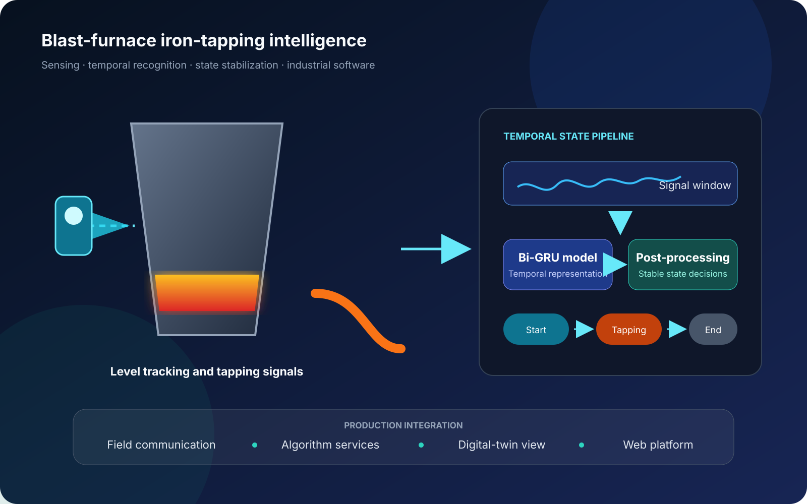

The system combines field instrumentation and communication with molten-iron level tracking, Bi-GRU state recognition, post-processing, and an operator interface. The industrial partner and furnace identifiers are omitted from the public version.

## Technical focus

- continuous extraction of level-related process signals;
- temporal state recognition using a Bi-GRU composite model;
- post-processing rules for stable tapping-state decisions;
- integration of algorithm services with industrial data and visualization.

## Public outputs

The work led to two first-author journal articles and the first-inventor patent **CN116678473B**, which covers a method for judging the tapping state of a blast-furnace hot-metal ladle.
