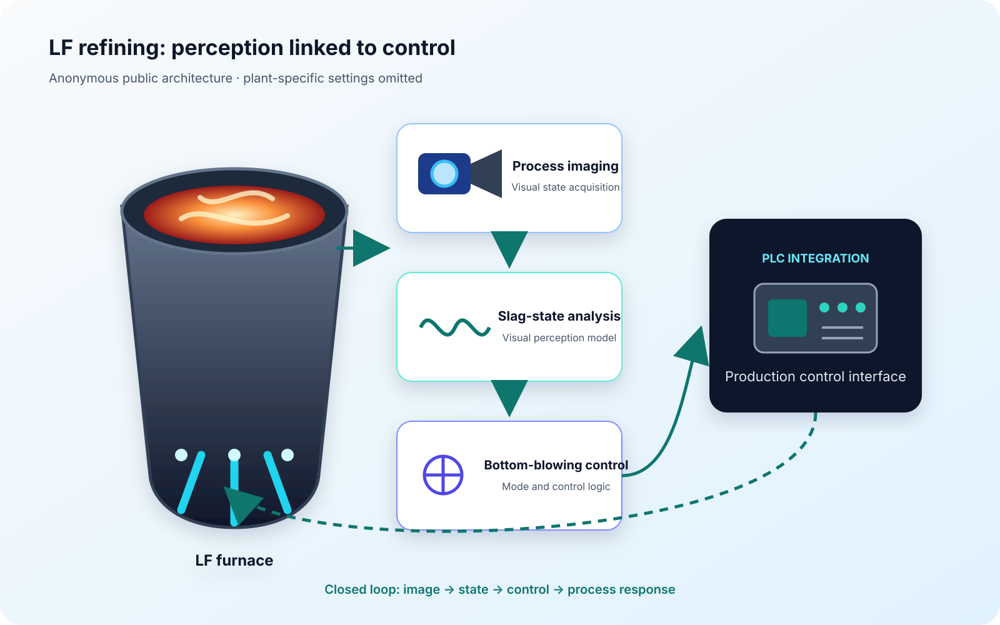

This project linked visual perception with process control for ladle-furnace refining. It combines furnace imaging and slag-state analysis with a bottom-blowing control model connected to the plant PLC. Partner and site identifiers are omitted.

## System scope

- process imaging at the LF furnace;
- visual analysis of slag state;
- bottom-blowing mode selection and control logic;
- PLC communication and integration with production software.

The public page reports the system boundary and completed integration only; confidential operating settings and plant-specific control rules are not disclosed.
