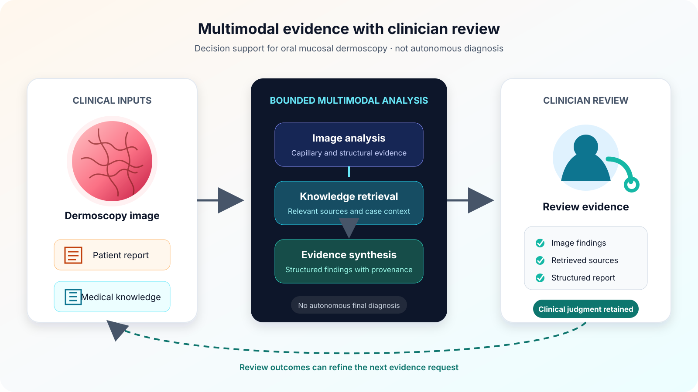

This ongoing project studies a multimodal workflow for oral mucosal dermoscopy. Images, patient reports, and medical knowledge are combined for structured analysis and clinician review. It is decision support and does not replace clinical judgment.

## Research components

- oral microvessel and capillary analysis from dermoscopy images;
- retrieval of relevant medical knowledge and case context;
- multimodal reasoning over images and structured patient information;
- evidence presentation and clinician review before any final interpretation.

Related work includes zero-shot capillary segmentation with SAM2 and connectivity-preserving slender-structure segmentation. Only figures from public research outputs are used on this page.
