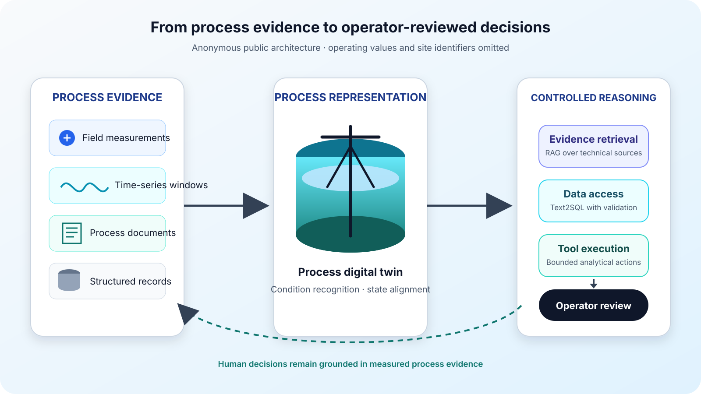

This project developed an operational decision-support workflow for a thickening–dewatering line. It joins field measurements, condition recognition, a process digital twin, and an LLM layer with retrieval, Text2SQL, and controlled tool use. The public description omits the industrial partner, site, and operating values.

## System scope

- process-data access and online condition recognition;
- a digital representation of the thickening–dewatering equipment;
- retrieval over technical documents and structured production data;
- tool-mediated analysis with the operator retained in the decision loop.

## Research connection

The project supplied an application setting for work on specialist-model adaptation under operating shifts. The associated preprint presents the method and evaluation protocol without exposing production identifiers.
